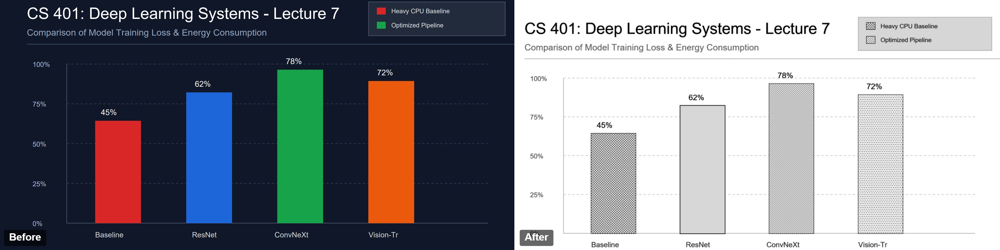

<div align="center">

# 🖨️ PDF MonoPrint

### Laser-Printer & Toner Optimizer for PDF Documents

**Convert ink-heavy slides, dark-mode presentations, and color diagrams into clean, toner-saving monochrome documents — 100% locally in your browser.**

[](https://aadish14.github.io/pdf-monoprint/)
[](https://aadish14.github.io/pdf-monoprint/)
[](https://aadish14.github.io/pdf-monoprint/)
[](LICENSE)

### [👉 Try the Live Web App (No Installation Needed)](https://aadish14.github.io/pdf-monoprint/)

<br />

<!-- Replace assets/hero-demo.png with your screenshot -->


</div>

---

## 💡 The Problem

Printing slides and documents on black-and-white laser printers often yields unreadable, toner-wasting results:
* **Dark backgrounds** soak paper in black toner, causing curling, smudging, and massive toner drain.
* **Color charts and lines** (e.g. red vs. blue vs. green series) collapse into identical shades of gray, making figures impossible to interpret.
* **Scanned handouts** have yellowish or gray paper textures that print as muddy background blocks.

## ✨ The Solution: What PDF MonoPrint Does

| Feature | Standard B&W Print | With PDF MonoPrint |
| :--- | :--- | :--- |
| **Dark Slides** | 100% black toner coverage (soggy paper) | **Pure white background, crisp black text** |
| **Color Charts** | Indistinguishable, identical gray shades | **Distinct diagonal stripes, crosshatching, or stipple dots** |
| **Thin Colored Lines** | Faint, low-contrast gray | **High-contrast morphological outline borders** |
| **Scanned Backgrounds** | Muddy gray paper noise | **Snapped to pure white (#FFFFFF)** |
| **Document Privacy** | Often uploaded to third-party servers | **100% client-side memory; zero network transmission** |

---

## 🚀 Key Features

### 🌓 Toner Saver Suite
- **Dark-Mode Inversion**: Reverses dark slide backgrounds to white and text to black, while automatically preserving original foreground ink colors for rule mapping.
- **Background Whitening**: Snaps off-white, cream, or scanned paper artifacts to pure white using an adjustable luminance threshold (140–250).

### 🎨 Intelligent Color-to-Pattern Mapping
- **Auto-Detection**: Scans the page into 36 color buckets (hue × brightness) to detect distinct inks with zero manual guessing.
- **Eyedropper Sampling**: Click any stroke or text on the original preview. A 5×5 weighted neighborhood filter automatically samples the true ink color instead of antialiased edge blur.
- **Geometric Hatch Patterns**:
  - Solid Shades (Hollow White to Solid Black)
  - Diagonal Stripes (customizable pitch and stroke)
  - Crosshatch Grid
  - Stipple Halftone Dots
- **Contrast Outlines**: Automatically applies separable morphological dilation ($O(W \times H)$) around colored regions for razor-sharp legibility on laser toner.

### 📑 Print-Ready Export
- **Selectable Resolution**: 150 DPI (compact), 200 DPI (balanced print), or 300 DPI (ultra-sharp). All hatch spacing and border widths scale proportionally with DPI.
- **Page Range Support**: Filter pages with standard syntax (e.g. `1-4, 7, 10-12`) with automatic bounds checking and deduplication.
- **Printable Legend Key**: Automatically inserts an explanatory monochrome key as either:
  1. A **Top Banner** on the first page (intelligently scales the page content so nothing is clipped).
  2. A **Standalone Cover Page** with pixel-rendered swatches, color names, and hex codes.

### 🔒 100% Privacy & Air-Gapped
- Zero server backend. All file reading (PDF.js), pixel filtering (Canvas 2D), and PDF building (jsPDF) runs in your local browser sandbox.
- Dependencies are bundled locally in `vendor/`—works completely offline with no network access required.

---

## 🛠️ How It Works

```
[ Input PDF ]
      │
      ▼
[ PDF.js Local Rasterizer ]
      │
      ▼
[ Precomputed Grayscale + HSV Typed Arrays ]
      │
      ├──> Toner Filter (Inversion + Whitening)
      ├──> Color Mask Extraction (HSV & RGB Metric)
      └──> Separable Dilation (O(W x H) Border Expansion)
      │
      ▼
[ Pattern Synthesis (Stripes / Crosshatch / Stipple) ]
      │
      ▼
[ jsPDF Memory Stream ] ──> [ High-Contrast Monochrome PDF ]
```

---

## 💻 Quick Start

Because PDF MonoPrint runs entirely in the browser without build tools or dependencies, getting started is instant:

### Option 1: Use the Hosted App
Visit the live site: **[https://aadish14.github.io/pdf-monoprint/](https://aadish14.github.io/pdf-monoprint/)**

### Option 2: Run Locally (Offline)
```bash
# Clone the repository
git clone https://github.com/Aadish14/pdf-monoprint.git

# Open directly in any browser (no server needed)
cd pdf-monoprint
start index.html   # On Windows (or open index.html in Chrome/Firefox/Safari)
```

---

## 📄 License

This software is available under the terms of the MIT License.

---

<div align="center">
  <sub>Developed by <a href="https://github.com/Aadish14">Aadish</a> &bull; If this project helped you save toner, please consider giving it a ⭐!</sub>
</div>
