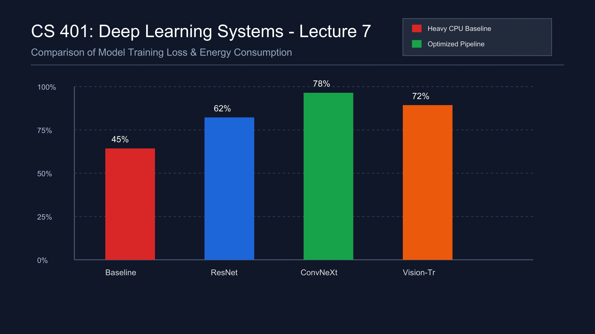
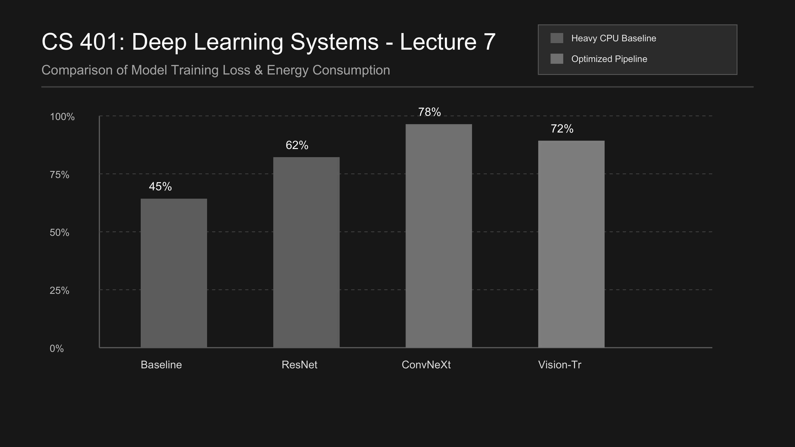
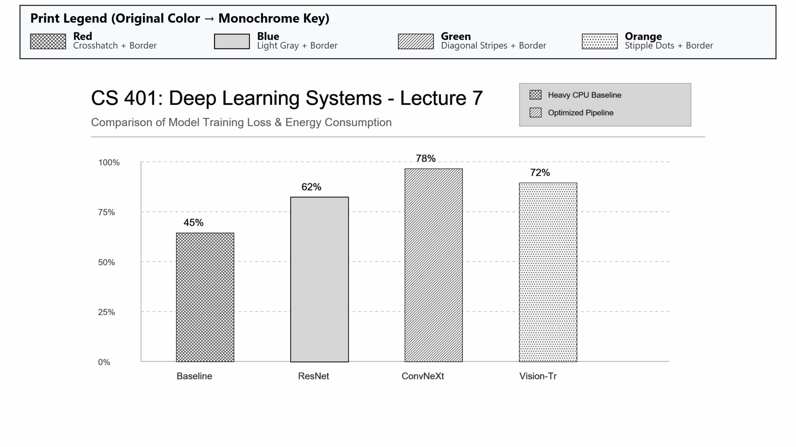

<div align="center">

# 🖨️ PDF MonoPrint

### Make Colors Distinguishable in Black & White PDFs when you print with your laser or black & white printer

**Never lose chart data, graph legends, or diagram meaning when printing in monochrome. PDF MonoPrint maps identical-looking gray tones into distinct geometric hatch patterns, textures, and outlines — 100% locally in your browser.**

[](https://aadish14.github.io/pdf-monoprint/)
[](https://aadish14.github.io/pdf-monoprint/)
[](https://aadish14.github.io/pdf-monoprint/)
[](LICENSE)

### [👉 Launch PDF MonoPrint Web App (No Installation Needed)](https://aadish14.github.io/pdf-monoprint/)

<br />

</div>

---

## 🔍 Visual Comparison: See the Difference

<br />

### 1. 🌈 Original Color Document
> *Looks vibrant on screens, but when sent to a standard black & white printer or photocopier, all color distinction is lost.*



<br /><br />

### 2. ❌ Standard B&W Printout (Without PDF MonoPrint)
> *All colors (Red, Blue, Green, Orange) collapse into the **exact same flat gray `#666666`**. The chart bars, pie segments, and legend keys are completely indistinguishable.*



<br /><br />

### 3. ✅ With PDF MonoPrint
> *Each color is automatically mapped into a **distinct tactile pattern & outline** (diagonal stripes, crosshatch, stipple halftone dots, thick borders) with an explanatory printable legend key.*



<br />

---

## 💡 The Problem: Colors Vanish in Black & White

When you print color-coded documents on a monochrome laser printer or run them through a photocopier:
* **Bar charts, pie charts & line graphs collapse:** Red, Green, Blue, and Orange all convert into the exact same muddy shade of gray. You can no longer tell which series is which.
* **Chart legends become useless:** The color key at the top of the chart prints as 4 identical gray squares.
* **Thin colored strokes vanish:** Faint colored lines and borders become low-contrast, unreadable gray smudges.
* **Dark-themed slides waste massive toner:** Full-bleed black or navy backgrounds soak paper with unnecessary black toner.

---

## ✨ The Solution: Tactile, Distinguishable Monochrome Textures

PDF MonoPrint replaces flat color fills with **tactile, high-contrast visual textures** so every single color remains instantly distinguishable, even on low-end black & white office printers or photocopiers:

| Color In Original Document | Standard B&W Printout (Without MonoPrint) | With PDF MonoPrint |
| :--- | :--- | :--- |
| **Red (Series A)** | Flat gray `#666666` | **Dense Diagonal Stripes + Dark Border** |
| **Blue (Series B)** | Flat gray `#666666` *(Identical!)* | **Crosshatch Grid + Crisp Border** |
| **Green (Series C)** | Flat gray `#777777` *(Indistinguishable!)* | **Stipple Halftone Dots** |
| **Orange (Series D)** | Flat gray `#777777` *(Indistinguishable!)* | **Hollow White + Thick Outline** |
| **Document Legend** | 4 identical gray squares | **Explanatory Key with Matching Textures** |
| **Dark Slide Backgrounds** | Soaked in black toner | **Inverted to pure white with crisp black text** |
| **Document Privacy** | Uploaded to cloud converters | **100% private in-browser execution (Air-Gapped)** |

---

## 🚀 Key Features

### 🎨 Distinguishable Color-to-Texture Mapping
- **Auto-Detection**: Scans the page into 36 color buckets (hue × brightness) to detect distinct inks with zero manual guessing.
- **Eyedropper Sampling**: Click any stroke or text on the original preview. A 5×5 weighted neighborhood filter automatically samples the true ink color instead of antialiased edge blur.
- **Geometric Hatch Patterns**:
  - Solid Shades (Hollow White to Solid Black)
  - Diagonal Stripes (customizable pitch and stroke)
  - Crosshatch Grid
  - Stipple Halftone Dots
- **Contrast Outlines**: Automatically applies separable morphological dilation ($O(W \times H)$) around colored regions for razor-sharp legibility on laser toner.

### 📑 Print-Ready Export with Legend Key
- **Monochrome Legend Key**: Automatically generates an explanatory key so anyone reading your printout knows exactly which pattern maps to which original color:
  1. **Top Banner** on the first page (intelligently scales the page content underneath so nothing is clipped).
  2. **Standalone Cover Sheet** with pixel-rendered swatches, color names, and original hex codes.
- **Selectable Resolution**: 150 DPI (compact), 200 DPI (balanced print), or 300 DPI (ultra-sharp). All hatch spacing and border widths scale proportionally with DPI.
- **Custom Page Range**: Supports ranges and single pages (e.g. `1-4, 7, 10-12`) with automatic bounds checking and deduplication.

### 🌓 Toner Saver Suite
- **Dark-Mode Inversion**: Reverses dark slide backgrounds to white and text to black, while automatically preserving original foreground ink colors for rule mapping.
- **Background Whitening**: Snaps off-white, cream, or scanned paper artifacts to pure white using an adjustable luminance threshold (140–250).

### 🔒 100% Privacy & Air-Gapped
- Zero server backend. All file reading (PDF.js), pixel filtering (Canvas 2D), and PDF building (jsPDF) runs in your local browser sandbox.
- Dependencies are bundled locally in `vendor/`—works completely offline with no network access required.

---

## 🛠️ How It Works

```
[ Color PDF (Charts / Diagrams) ]
               │
               ▼
   [ PDF.js Local Rasterizer ]
               │
               ▼
[ Precomputed Grayscale + HSV Buffers ]
               │
               ├──> Color Classification (Competitive Nearest-Rule Assignment)
               ├──> Texture Synthesis (Stripes / Crosshatch / Stipple Dots)
               └──> Separable Dilation (Contrast Outline Expansion)
               │
               ▼
[ Printable Monochrome Legend Generator ]
               │
               ▼
[ jsPDF Local Compiler ] ──> [ 100% Distinguishable Monochrome PDF ]
```

---

## 💻 Quick Start

Because PDF MonoPrint runs entirely in the browser without build tools or dependencies, getting started is instant:

### Option 1: Use the Hosted Web App
Visit the live site: **[https://aadish14.github.io/pdf-monoprint/](https://aadish14.github.io/pdf-monoprint/)**

### Option 2: Run Locally (Air-Gapped Offline)
```bash
# Clone the repository
git clone https://github.com/Aadish14/pdf-monoprint.git

# Open directly in any browser (no server needed)
cd pdf-monoprint
start index.html   # On Windows (or open index.html in any browser)
```

---

## 📄 License

This software is available under the terms of the MIT License.

---

<div align="center">
  <sub>Developed by <a href="https://github.com/Aadish14">Aadish</a> &bull; If this project helped you make your monochrome prints readable, please consider giving it a ⭐!</sub>
</div>
